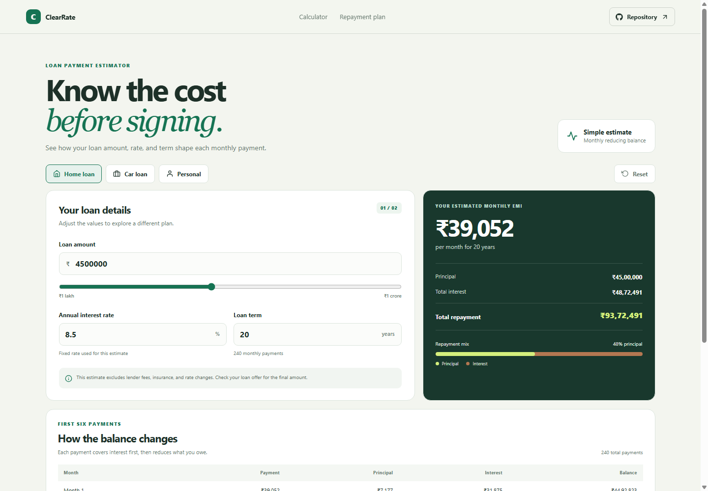

# ClearRate EMI Calculator

ClearRate helps borrowers estimate a monthly loan payment and understand how the total repayment is divided between principal and interest.

## What it includes

- Example presets for home, car, and personal loans.
- Editable loan amount, annual interest rate, and loan term.
- A live EMI estimate, total interest, total repayment, and principal-to-interest bar.
- A first-six-payment schedule showing payment, principal, interest, and remaining balance.
- Responsive layout, a fixed header, repository link, and floating Back to top button.

## How to use it

Choose a loan example or enter your own amount, rate, and term. The estimate recalculates as you edit the fields. Use the repayment table to see how the first six monthly payments affect the balance. Reset returns the calculator to its home-loan example.

## Calculation and data

The calculator uses the standard fixed-rate monthly reducing-balance formula. It assumes the annual interest rate stays constant and rounds displayed amounts to whole rupees. It does not store personal data or contact a lender. Fees, insurance, taxes, and lender-specific rounding are excluded, so the result is an estimate rather than a loan offer.

## Run locally

Run npm install to install dependencies, npm run dev to start the local server, npm run lint and npm run build to check the project, and npm run deploy to publish it to GitHub Pages.

Deployed site: https://a2rp.github.io/emi-calculator/

## Future improvements

Ideas that are not implemented yet: extra-payment scenarios, a full month-by-month schedule export, and side-by-side comparisons of multiple loan offers.

## Links

- Portfolio: [https://www.ashishranjan.net](https://www.ashishranjan.net)
- GitHub: [https://github.com/a2rp](https://github.com/a2rp)
- CodePen: [https://codepen.io/ash1198](https://codepen.io/ash1198)
- LinkedIn: [https://www.linkedin.com/in/aashishranjan](https://www.linkedin.com/in/aashishranjan)
- Facebook: [https://www.facebook.com/theash.ashish/](https://www.facebook.com/theash.ashish/)
- YouTube: [https://www.youtube.com/@ashishranjan-ashz?sub_confirmation=1](https://www.youtube.com/@ashishranjan-ashz?sub_confirmation=1)
- Email: [mailto:ash.ranjan09@gmail.com](mailto:ash.ranjan09@gmail.com)

## Support

- Support: [https://a2rp-donation-page.netlify.app/](https://a2rp-donation-page.netlify.app/)
- Buy Me a Coffee: [https://buymeacoffee.com/ashishranjan](https://buymeacoffee.com/ashishranjan)
- Patreon: [https://www.patreon.com/ashishranjan](https://www.patreon.com/ashishranjan)